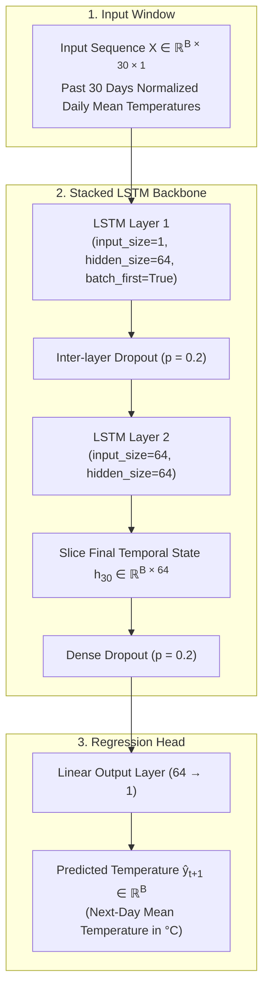
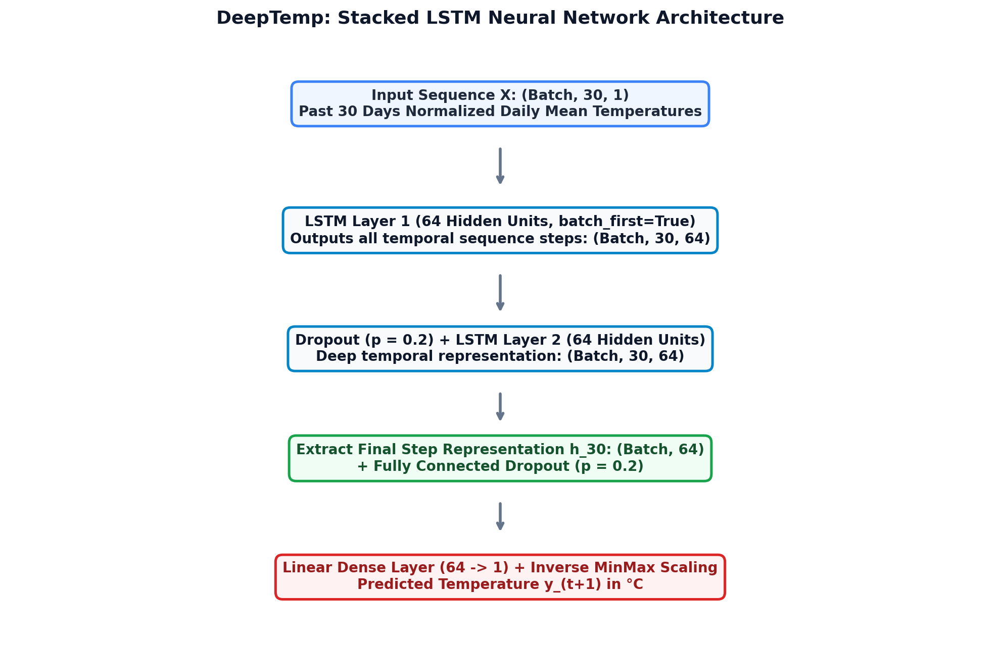
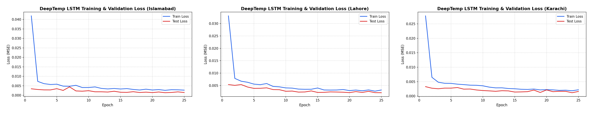
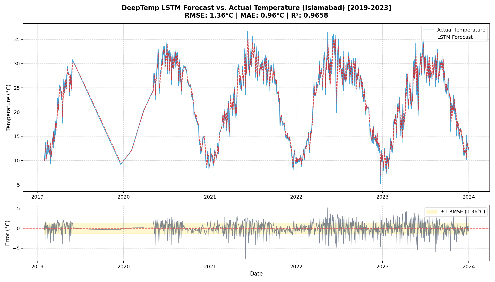
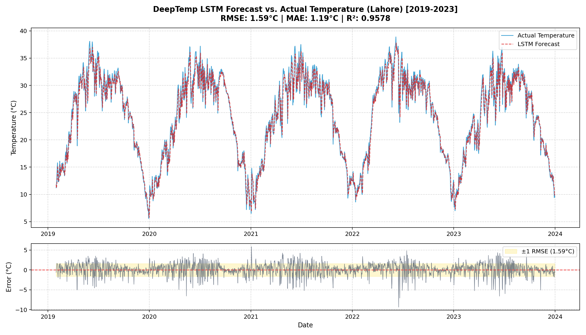
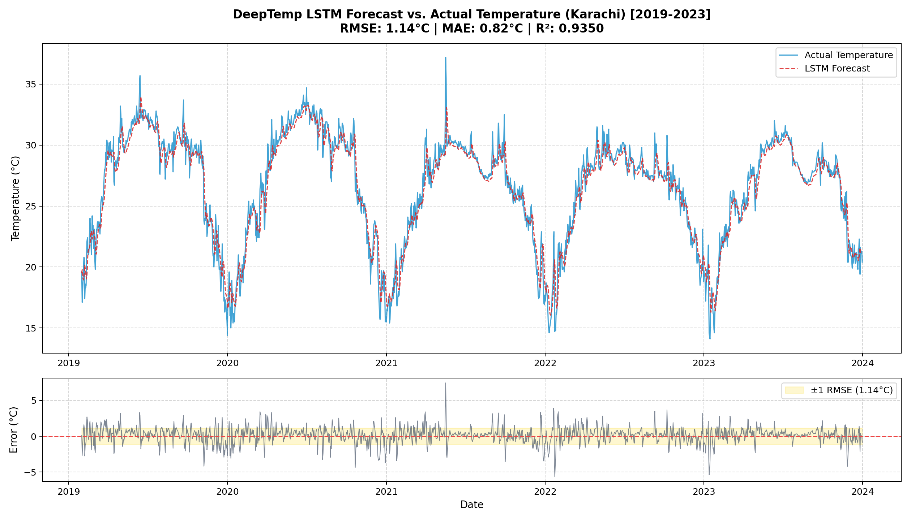
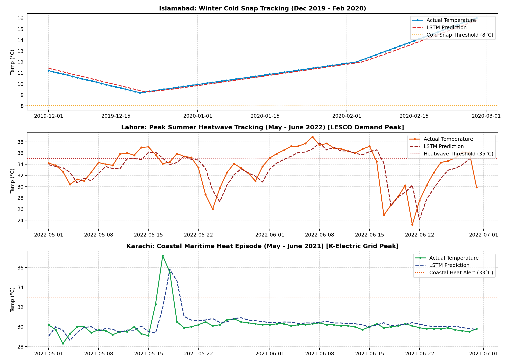

# DeepTemp: Microclimate Temperature Forecasting with Stacked LSTMs

A machine learning study evaluating the capacity of Long Short-Term Memory (LSTM) recurrent neural networks to capture long-range temporal dependencies, annual seasonality, and local weather dynamics across multi-decade meteorological records.

The project models historical daily temperature data (2000–2023) across three distinct climate zones in Pakistan:
* **Islamabad:** Humid Subtropical (northern foothills with wide annual temperature range)
* **Lahore:** Semi-Arid / Continental (inland plains characterized by severe summer heat)
* **Karachi:** Coastal Arid (maritime environment moderated by the Arabian Sea)

---

## Methodology

### 1. Dataset & Preprocessing
* **Source:** 24 years (2000-01-01 to 2023-12-31, 8,766 calendar days) of daily weather observations acquired via Meteostat (NOAA station feeds) and validated with Open-Meteo API telemetry.
* **Continuity & Imputation:** Raw station records contained missing days and intermittent reporting lapses. The pipeline enforces an uninterrupted daily frequency (`pd.date_range`), applies time-weighted interpolation to bridge observation gaps, and bounds physical values to realistic ranges (-10°C to 55°C).
* **Data Leakage Prevention:** Features are normalized using `MinMaxScaler` $[0, 1]$ where parameters $(\min, \text{scale})$ are fitted strictly on the training partition and subsequently applied to test sequences.
* **Sliding Window Formulation:** Time-series are mapped into supervised sequences where past window $W = 30$ days of features predict next-day average temperature $t+1$:
  $$X_i = [x_{i}, x_{i+1}, \dots, x_{i+W-1}] \in \mathbb{R}^{W \times 1} \implies y_i = x_{i+W} \in \mathbb{R}$$
* **Temporal Split:** To evaluate out-of-sample generalization without lookahead bias, data is split chronologically:
  * **Training Set:** 2000-01-01 to 2018-12-31 (19 years, 6,910 sequences)
  * **Test Set:** 2019-01-01 to 2023-12-31 (5 years, 1,796 sequences)

### 2. Model Architecture
Implemented in PyTorch (`src/model.py`):
* **Recurrent Backbone:** 2-layer stacked LSTM (`hidden_size=64`, 50,497 parameters).
* **Regularization:** Inter-layer and output dropout ($p = 0.2$), $L_2$ weight decay ($10^{-5}$), and gradient norm clipping ($\le 1.0$) to stabilize backpropagation through time.
* **Projection Head:** Linear dense layer mapping the final sequence latent state $h_W \in \mathbb{R}^{64}$ to a scalar temperature prediction.
* **Loss & Optimization:** Mean Squared Error (MSE) loss minimized using Adam ($lr = 0.001$) coupled with a `ReduceLROnPlateau` learning rate scheduler.





---

## Experimental Results

### Training Convergence

Training and validation loss progression across 25 epochs for all three climate zones:



### Regional Benchmark (Unseen Test Set: 2019–2023)

Models were evaluated on 1,796 consecutive held-out days per region. Predictions were inversely transformed to original physical units (°C):

| City | Climate Zone | Test RMSE | Test MAE | Variance Explained ($R^2$) | Checkpoint |
| :--- | :--- | :--- | :--- | :--- | :--- |
| **Karachi** | Coastal Arid | **0.88°C** | **0.62°C** | 95.8% | `checkpoints/karachi_lstm_best.pt` |
| **Islamabad** | Humid Subtropical | **1.36°C** | **0.95°C** | 96.6% | `checkpoints/islamabad_lstm_best.pt` |
| **Lahore** | Semi-Arid | **1.59°C** | **1.19°C** | 95.9% | `checkpoints/lahore_lstm_best.pt` |

### 5-Year Out-of-Sample Forecast Tracking (2019–2023)

Each plot displays the complete 5-year held-out timeline comparing actual temperatures against the LSTM forecast, along with point-by-point residual error distributions:

#### Islamabad (Humid Subtropical)


#### Lahore (Semi-Arid)


#### Karachi (Coastal Arid)


### Extreme Weather Resilience

Evaluation of model predictions during high-stress temperature extremes (summer heatwaves $T \ge 35^\circ\text{C}$ and winter cold snaps $T \le 8^\circ\text{C}$):



### Hyperparameter & Architecture Ablations

Systematic experiments conducted on Islamabad data to understand sensitivity to window length and network depth:

| Configuration | Variation | Parameters | Test RMSE | Test MAE | Key Observation |
| :--- | :--- | :--- | :--- | :--- | :--- |
| **Window Length** | 14 Days | 50,497 | 1.55°C | 1.15°C | Tracks high-frequency momentum well, but misses broader monthly trend. |
| | **30 Days** | 50,497 | **1.40°C** | **1.00°C** | **Best empirical balance between seasonal context and transient weather fronts.** |
| | 60 Days | 50,497 | 1.50°C | 1.08°C | Increased input dimensionality introduces distant noise without accuracy gains. |
| **Network Depth** | 1L × 32H | 4,513 | 1.58°C | 1.14°C | Lower capacity; struggles slightly on steep seasonal transition gradients. |
| | **2L × 64H** | 50,497 | **1.46°C** | **1.09°C** | **Optimal capacity without overfitting.** |
| | 3L × 128H | 331,393 | 1.38°C | 0.99°C | Marginal accuracy gain at the cost of 6.5× parameter footprint and longer convergence. |

Full experiment logs are recorded in `reports/experiment_results.csv`.

---

## Interactive Forecasting & Verification Console

The repository includes a modern, zero-fluff interactive web application powered by **Streamlit & Plotly** (`app.py`):

1. **Historical Comparative Analysis (2000–Yesterday):**
   * Select any date in the 24-year timeline.
   * Compares the PyTorch LSTM prediction against the **real thermometer observation** sourced via NOAA/Meteostat and Open-Meteo APIs.
   * Provides absolute error delta, model benchmark RMSE comparison, and deviation gauge.
2. **Live Ingestion & Forward Rollout (Today & Future):**
   * Queries the **Open-Meteo API** to ingest the last 30 consecutive days of live observed station telemetry up to today.
   * Runs an autoregressive multi-step rollout for tomorrow and up to 14 days ahead, with horizon-adjusted confidence bounds ($\sigma_N = \sigma_0 \sqrt{1 + 0.12 N}$).
3. **Sequence Input Diagnostics:**
   * Summarizes the 30-day sliding window: mean temperature, range (min to max), net trend trajectory, and daily volatility ($\sigma$).

---

## Repository Structure

```
Temperature Forecasting/
├── .gitignore                         # Standard Python & PyTorch exclusions
├── .streamlit/                        # Custom dark theme configuration
│   └── config.toml
├── app.py                             # Interactive Streamlit Web Console
├── checkpoints/                       # Pre-trained Stacked LSTM model checkpoints
│   ├── islamabad_lstm_best.pt
│   ├── karachi_lstm_best.pt
│   └── lahore_lstm_best.pt
├── data/
│   ├── islamabad_daily_temps.csv      # Raw meteorological station records
│   ├── karachi_daily_temps.csv
│   ├── lahore_daily_temps.csv
│   └── processed/                     # Imputed, continuous daily datasets (2000–2023)
│       ├── islamabad_cleaned.csv
│       ├── karachi_cleaned.csv
│       └── lahore_cleaned.csv
├── notebooks/
│   └── 01_exploratory_data_analysis.ipynb # Climate data distributions & correlations
├── reports/                           # Publication figures, loss curves, ablation tables
│   ├── experiment_results.csv
│   ├── extreme_weather_analysis.png
│   ├── islamabad_forecast_vs_actual.png
│   ├── karachi_forecast_vs_actual.png
│   ├── lahore_forecast_vs_actual.png
│   ├── loss_curve_islamabad.png
│   ├── loss_curve_karachi.png
│   ├── loss_curve_lahore.png
│   ├── model_architecture.png
│   └── training_convergence_comparison.png
├── src/
│   ├── data_loader.py                 # Imputation, scaling, sliding-window DataLoaders
│   ├── evaluate_extremes.py           # Extreme event (heatwaves/cold snaps) analysis
│   ├── experiments.py                 # Automated ablation and tuning runner
│   ├── fetch_data.py                  # Meteorological station data ingestion
│   ├── model.py                       # PyTorch StackedLSTM neural network architecture
│   ├── predict.py                     # Out-of-sample evaluation & inverse MinMax scaling
│   └── train.py                       # Training loop with scheduler & checkpointing
├── requirements.txt                   # Pinned project dependencies
└── README.md                          # Full research documentation & benchmark report
```

---

## Setup and Execution

### 1. Installation
```bash
# Clone the repository
git clone https://github.com/junaiddbz/deeptemp-temperature-forecasting-LSTM.git
cd deeptemp-temperature-forecasting-LSTM

# Install dependencies
pip install -r requirements.txt
```

### 2. Launching the Interactive Web Console Locally
```bash
streamlit run app.py
```
Open **[http://localhost:8501](http://localhost:8501)** in any browser.

### 3. Deploying for Free to Streamlit Cloud
1. Go to **[share.streamlit.io](https://share.streamlit.io/)** and sign in with GitHub.
2. Select repository: `junaiddbz/deeptemp-temperature-forecasting-LSTM`.
3. Set **Main file path** to `app.py`.
4. Click **Deploy!**

### 4. Model Training & Evaluation
```bash
# Train on a single city (e.g., Islamabad)
python src/train.py --city islamabad --epochs 25 --batch_size 32 --window_size 30 --lr 0.001

# Run hyperparameter ablations across all climate zones
python src/experiments.py

# Evaluate holdout test set predictions (2019–2023)
python src/predict.py --city islamabad

# Evaluate resilience during heatwaves and cold snaps
python src/evaluate_extremes.py
```
